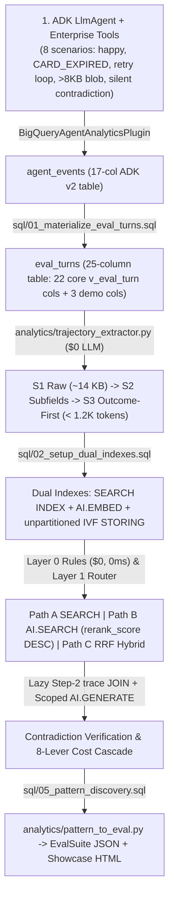

# Combined CUJ: BigQuery Trace Search, Cost-Aware Routing & Pattern-to-Eval Demo

This demo combines **deterministic trajectory extraction**, **BigQuery dual indexes** (`SEARCH INDEX` + autonomous `AI.EMBED` + `VECTOR INDEX` / `AI.SEARCH`), **4-layer cost-aware query routing**, **8-lever eval cost reduction**, and **continuous pattern-to-eval regression discovery** inside one runnable Google ADK + BigQuery Agent Analytics SDK bundle.

## Architecture



## Key Design Highlights

1. **Deterministic `S1` vs `S2` vs `S3` Trajectory Extraction (`$0` Ingest LLM Cost)**
   - **`S1` (Raw `trace` JSON):** Serializes the full `v_eval_turn.trace` JSON, including repeated `agents.<id>.instruction` (~6 KB+) and tool schema definitions (`function_declarations`) plus verbose tool outputs. Frequently exceeds the `2,048`-token embedding budget before reaching the turn outcome.
   - **`S2` (Subfields Only):** Drops `agents` completely and retains `turns[*].events[*]`, eliminating prompt boilerplate while leaving large tool payloads unclipped.
   - **`S3` (Outcome-First + Regex/Head-Tail Cap, default `_ai_index_trajectory`):** Prepends `[OUTCOME: root_agent=... has_error=... tool_calls=... tool_errors=... loop=... latency_ms=...]`, strips HTML/hex noise via compiled regexes, and applies head+tail clamping so trailing error codes (`CARD_EXPIRED`, `DEADLINE_EXCEEDED`, contradiction text) always fit inside `< 1,200` estimated tokens (`<= 4,800` chars).

2. **Verified BigQuery Schema & Dual-Index Constraints**
   - **`eval_turns` Schema Alignment:** Uses `has_error` and `root_agent` (matching `v_eval_turn`, which omits `status` and `root_agent_name`), plus derived `error_summary`, `raw_trace_bytes`, and `_ai_index_trajectory`.
   - **Autonomous Embedding & `AI.SEARCH`:** Adds `_ai_index_trajectory_embedding` via `GENERATED ALWAYS AS (AI.EMBED(_ai_index_trajectory, model => 'embeddinggemma-300m', task_type => 'RETRIEVAL_DOCUMENT')) STORED OPTIONS (asynchronous = TRUE)`. Queries via `AI.SEARCH` pass source `STRING` column `'_ai_index_trajectory'` and `@search_query`, project only `STORING`-covered columns in the subquery (never the embedding column), and sort `ORDER BY rerank_score DESC` when `rerank => TRUE`.
   - **Scale-Aware Index Behavior:**
     - `CREATE VECTOR INDEX ... PARTITION BY` is disallowed on generated embedding columns and `IVF` indexes, so `idx_turns_vec` stays unpartitioned.
     - BigQuery rejects `CREATE VECTOR INDEX ... OPTIONS (index_type = 'IVF')` on tables with `< 5,000` rows. At default demo scale, the setup script logs `SKIPPED_BELOW_5000_ROWS` and runs `AI.SEARCH` / `AI.EMBED` + `ML.DISTANCE` directly without failing. Pass `--with-vector-index-scale` to seed `5,000` deterministic rows and build the `IVF` index end-to-end.
     - `CREATE SEARCH INDEX` succeeds on any table size; in production, search indexes populate at `>= 10 GiB` and rewrite queries at `>= 100` pruned files, falling back transparently to table scan at small demo scale.

3. **4-Layer Cost-Aware Routing & Modeled 8-Lever Eval Cascade**
   - **Layer 0 (`$0`, `0 ms`):** Deterministic rules classify empty queries, quoted `"..."` phrases, session/invocation IDs, and `UPPER_SNAKE_CASE` constants (`CARD_EXPIRED`) to `KEYWORD`, and mixed tool + behavioral queries to `HYBRID`.
   - **Layer 1 (Ambiguous Queries):** Uses Developer API `client.decisions.create(model="gemini-decision-1", ...)` (`0` decode tokens) when `GEMINI_API_KEY` and `client.decisions` are available, or Vertex AI `gemini-4-hydrogen` (`location="global"`, `thinking_level="LOW"`, structured JSON) as the zero-key-friction default, escalating low-confidence (`< 0.70`) predictions to `HYBRID`.
   - **Layer 2 & Layer 3:** Step-1 retrieval reads `0` bytes of raw `trace` JSON; Step-2 lazy hydration loads `trace` only for an expanded `(session_id, invocation_id)`; Layer 3 runs scoped `AI.GENERATE` (`thinking_level="LOW"`) strictly on `top_k` candidates to verify silent contradictions.

4. **Continuous Pattern Discovery -> `EvalSuite`**
   - Groups anomalous turns (`SILENT_CONTRADICTION`, `TOOL_LOOP`, `TOKEN_BLOAT`, `EXACT_ERROR_SPIKE`) and exports a balanced `bigquery_agent_analytics.EvalSuite` JSON (`eval_dataset_generated.json`) verified with `suite.check_health()`.

## Observed Live Benchmark Snapshot

Verified against live BigQuery (`US` multi-region) and Vertex AI (`gemini-4-hydrogen` in `global`, `thinking_level="LOW"`, session batch `20261124_174855`); see [`VERIFICATION.md`](VERIFICATION.md) for the full ledger:

- **`S1` -> `S2` -> `S3` Trajectory Compression (`$0.00` ingest LLM):** Aggregate payload shrank `93.2%` (`106,185 B -> 7,218 B`). Average turn size dropped from `13,273 B` (`3,318` est. tokens, `8/8 > 2,048`) in `S1` and `3,018 B` (`755` est. tokens, `1/8 > 2,048`) in `S2` to **`902 B` (`226` est. tokens, `0/8 > 2,048`)** in `S3`; bloated audit outlier `scn_05` shrank from `24,996 B` (`6,249` tokens) to `977 B` (`245` tokens) while preserving `AUDIT_SYNC_WARNING` and `CHECKSUM_MISMATCH`.
- **BigQuery Query Scan Reduction & Scale `IVF` Proof:**
  - `8`-row live run (`8/8` `AI.EMBED` ready): `KEYWORD` Step-1 scan `8,759 B` (`-90.1%`, `10.1x` reduction vs `88,331 B` raw `trace` baseline), `AI.SEARCH` (`rerank_score DESC`) `57,927 B` (`-34.4%`).
  - `5,074`-row `--with-vector-index-scale` run (`2,000/5,074` initial async ready): `CREATE VECTOR INDEX ... IVF` (`CREATED` live), `KEYWORD` scan `1,948,168 B` (`1.95 MB`, `-94.7%` / `18.8x`) and `AI.SEARCH` `14,240,168 B` (`14.24 MB`, `-61.1%`) vs `36,642,883 B` raw baseline.
- **4-Layer Routing, Scoped `AI.GENERATE` & Modeled 8-Lever Cost Cascade:** Layer 0 resolved `q1`/`q2`/`q5` in `0.0 ms` (`$0.00`); Layer 1 (`gemini-4-hydrogen`, `thinking_level="LOW"`) routed `q3` (`2,534.82 ms`) and `q4` (`1,511.00 ms`); scoped `AI.GENERATE` flagged `sess_03` (`SILENT_CONTRADICTION`, `conf=1.0`) while correctly classifying `sess_08` (`EXACT_ERROR`, `conf=0.99`) when the agent obeyed cancellation policy; parameterized from live `S1`/`S3` byte counts under uniform `$0.30/$2.50` compact judge pricing, the modeled 8-lever cascade (`MODELED_PROJECTION`) projects `$16.7051` (`Arm 1`) down to `$0.0728` (`Arm 4`, `-99.56%` per `1K` evals); `pattern_to_eval.py` exported a balanced `6`-task `EvalSuite` backed by 100% real BigQuery session IDs (`balance_ratio=0.333`, `0` health warnings).

## Layout

```text
combined_cuj_trace_search_demo/
  agent/
    tools.py                   # Enterprise ops tools + secret-scrubbing classifier
    prompts_and_scenarios.py   # 8 deterministic/live demo scenarios
    run_live_demo.py           # ADK + BQAA Plugin runner (--mock-live supported)
  analytics/
    trajectory_extractor.py    # Pure-Python S1/S2/S3 extractors & token accounting
    query_router.py            # Layer 0 rules + Layer 1 Decisions/Flash router
    index_and_search.py        # Dual-index setup, Path A/B/C search, Layer 3 verify
    pattern_to_eval.py         # Pattern discovery -> EvalSuite + 8-lever cascade
    seed_scale_benchmark.py    # Optional 5,000-row IVF vector index seeder
  sql/
    01_materialize_eval_turns.sql
    02_setup_dual_indexes.sql
    03_search_keyword_and_semantic.sql
    04_verify_contradictions_ai_generate.sql
    05_pattern_discovery.sql
  report/
    build_showcase_html.py     # Self-contained 0600 Adaptive Workbench HTML builder
  tests/
    test_trajectory_extractor_and_agent.py
    test_router_sql_and_patterns.py
    test_showcase_html_and_hygiene.py
  combined_cuj_trace_search_demo.ipynb
  setup.sh / run_e2e_demo.sh / reset.sh
  DEMO_NARRATION.md / VERIFICATION.md
```

## Quickstart

### 1. Offline Mode (Zero GCP Credentials Required)

```bash
cd examples/combined_cuj_trace_search_demo
./run_e2e_demo.sh --offline
```

Outputs `live_demo_results.json`, `search_results.json`, `pattern_eval_report.json`, `eval_dataset_generated.json`, and `showcase.html` under `reports/run_<timestamp>/`.

### 2. Live BigQuery + Vertex AI Mode

```bash
cd examples/combined_cuj_trace_search_demo
export PROJECT_ID="your-gcp-project-id"
./setup.sh
./run_e2e_demo.sh
```

Optional flags:
- `--with-vector-index-scale`: Seeds `5,000` synthetic rows so `CREATE VECTOR INDEX ... IVF` executes against live BigQuery.
- `--no-rerank`: Uses cosine `distance ASC` ordering without requiring `roles/discoveryengine.viewer`.

### 3. Build Showcase HTML Directly from Fixture

```bash
PYTHONDONTWRITEBYTECODE=1 PYTHONSAFEPATH=1 python3 -m report.build_showcase_html \
  --demo-fixture --output reports/showcase_preview.html
```

### 4. Run Unit & Hygiene Tests

```bash
# From repo root:
pytest --tb=short -q tests/examples/test_combined_cuj_trace_search_demo.py
```

### 5. Clean Up

```bash
./reset.sh                     # Remove local reports/ and caches
./reset.sh --drop-demo-tables  # Also drop demo BigQuery tables in .env
```
