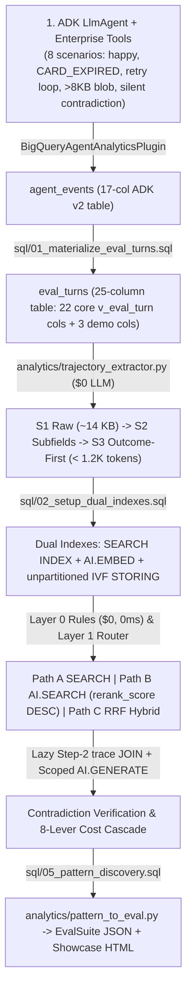

# Combined CUJ: BigQuery Trace Search, Cost-Aware Routing & Pattern-to-Eval Demo

This demo combines **deterministic trajectory extraction**, **BigQuery dual indexes** (`SEARCH INDEX` + autonomous `AI.EMBED` + `VECTOR INDEX` / `AI.SEARCH`), **4-layer cost-aware query routing**, **8-lever eval cost reduction**, and **continuous pattern-to-eval regression discovery** inside one runnable Google ADK + BigQuery Agent Analytics SDK bundle.

## Architecture



## Key Design Highlights

1. **Deterministic `S1` vs `S2` vs `S3` Trajectory Extraction (`$0` Ingest LLM Cost)**
   - **`S1` (Raw `trace` JSON):** Serializes the full `v_eval_turn.trace` JSON, including repeated `agents.<id>.instruction` (~6 KB+) and tool schema definitions (`function_declarations`) plus verbose tool outputs. Frequently exceeds the `2,048`-token embedding budget before reaching the turn outcome.
   - **`S2` (Subfields Only):** Drops `agents` completely and retains `turns[*].events[*]`, eliminating prompt boilerplate while leaving large tool payloads unclipped.
   - **`S3` (Outcome-First + Regex/Head-Tail Cap, default `_ai_index_trajectory`):** Prepends `[OUTCOME: root_agent=... has_error=... tool_calls=... tool_errors=... loop=... latency_ms=...]`, strips HTML/hex noise via compiled regexes, and applies head+tail clamping so trailing error codes (`CARD_EXPIRED`, `DEADLINE_EXCEEDED`, contradiction text) always fit inside `< 1,200` estimated tokens (`<= 4,800` chars).

2. **Verified BigQuery Schema & Dual-Index Constraints**
   - **`eval_turns` Schema Alignment:** Uses `has_error` and `root_agent` (matching `v_eval_turn`, which omits `status` and `root_agent_name`), plus derived `error_summary`, `raw_trace_bytes`, and `_ai_index_trajectory`.
   - **Autonomous Embedding & `AI.SEARCH`:** Adds `_ai_index_trajectory_embedding` via `GENERATED ALWAYS AS (AI.EMBED(_ai_index_trajectory, model => 'embeddinggemma-300m', task_type => 'RETRIEVAL_DOCUMENT')) STORED OPTIONS (asynchronous = TRUE)`. Queries via `AI.SEARCH` pass source `STRING` column `'_ai_index_trajectory'` and `@search_query`, project only `STORING`-covered columns in the subquery (never the embedding column), and sort `ORDER BY rerank_score DESC` when `rerank => TRUE`.
   - **Scale-Aware Index Behavior:**
     - `CREATE VECTOR INDEX ... PARTITION BY` is disallowed on generated embedding columns and `IVF` indexes, so `idx_turns_vec` stays unpartitioned.
     - BigQuery rejects `CREATE VECTOR INDEX ... OPTIONS (index_type = 'IVF')` on tables with `< 5,000` rows. At default demo scale, the setup script logs `SKIPPED_BELOW_5000_ROWS` and runs `AI.SEARCH` / `AI.EMBED` + `ML.DISTANCE` directly without failing. Pass `--with-vector-index-scale` to seed `5,000` deterministic rows and build the `IVF` index end-to-end.
     - `CREATE SEARCH INDEX` succeeds on any table size; in production, search indexes populate at `>= 10 GiB` and rewrite queries at `>= 100` pruned files, falling back transparently to table scan at small demo scale.

3. **4-Layer Cost-Aware Routing & Modeled 8-Lever Eval Cascade**
   - **Layer 0 (`$0`, `0 ms`):** Deterministic rules classify empty queries, quoted `"..."` phrases, session/invocation IDs, and `UPPER_SNAKE_CASE` constants (`CARD_EXPIRED`) to `KEYWORD`, and mixed tool + behavioral queries to `HYBRID`.
   - **Layer 1 (Ambiguous Queries):** Uses Gemini Decisions API (`gemini-decision-1`, `0` output tokens, via SDK `client.decisions.create` when available or direct `POST /decisions` REST fallback when `GEMINI_API_KEY` or `GEMINI_DECISIONS_API_BASE` is configured), or falls back to Vertex AI `gemini-4-hydrogen` (`location="global"`, `thinking_level="LOW"`, structured JSON) when no Decisions credentials are set, escalating low-confidence (`< 0.70`) predictions to `HYBRID`.
   - **Layer 2 & Layer 3:** Step-1 retrieval reads `0` bytes of raw `trace` JSON; Step-2 lazy hydration loads `trace` only for an expanded `(session_id, invocation_id)`; Layer 3 runs scoped `AI.GENERATE` (`thinking_level="LOW"`) strictly on `top_k` candidates to verify silent contradictions.

4. **Continuous Pattern Discovery -> `EvalSuite`**
   - Groups anomalous turns (`SILENT_CONTRADICTION`, `TOOL_LOOP`, `TOKEN_BLOAT`, `EXACT_ERROR_SPIKE`), exports a balanced `bigquery_agent_analytics.EvalSuite` JSON (`eval_dataset_generated.json`) verified with `suite.check_health()`, and writes a demo-local deterministic threshold evaluation (`suite_evaluation`) into `pattern_eval_report.json` alongside the suite health check (for full LLM/trajectory evaluation against live traces, run the SDK evaluator against the exported `EvalSuite` JSON).

## Observed Live Benchmark Snapshot

Verified against live BigQuery (`US` multi-region), Vertex AI (`gemini-4-hydrogen` in `global`, `thinking_level="LOW"`), and Gemini Decisions API (`gemini-decision-1`, `L1_DECISIONS_API`, `0` output tokens, session batch `20261124_200850`); see [`VERIFICATION.md`](VERIFICATION.md) for the full ledger:

- **`S1` -> `S2` -> `S3` Trajectory Compression (`$0.00` ingest LLM):** Aggregate payload shrank `93.3%` (`106,049 B -> 7,096 B`). Average turn size dropped from `13,256 B` (`3,314` est. tokens, `8/8 > 2,048`) in `S1` and `3,023 B` (`756` est. tokens, `1/8 > 2,048`) in `S2` to **`887 B` (`222` est. tokens, `0/8 > 2,048`)** in `S3`; bloated audit outlier `scn_05` shrank from `25,066 B` (`6,267` tokens) to `1,045 B` (`262` tokens) while preserving `AUDIT_SYNC_WARNING` and `CHECKSUM_MISMATCH`, and silent contradiction `scn_03` (`sess_03_silent_contradiction_refund_20261124_200850`) shrank from `11,477 B` to `709 B` (`-93.8%`).
- **BigQuery Query Scan Reduction & Scale `IVF` Proof:**
  - `8`-row live run (`8/8` `AI.EMBED` ready): `KEYWORD` Step-1 scan `8,634 B` (`-90.2%`, `10.2x` reduction vs `88,194 B` raw `trace` baseline), `AI.SEARCH` (`rerank_score DESC`) `57,802 B` (`-34.5%`).
  - `5,091`-row `--with-vector-index-scale` historical measurement (measured prior to session-scoped `eval_turns` filtering, which now materializes `8 + 5,000 = 5,008` rows in scale mode; `1,000/5,091` initial async ready): `CREATE VECTOR INDEX ... IVF` (`CREATED` live, `PENDING_INDEX_CREATION` during async build), `KEYWORD` scan `1,966,485 B` (`1.97 MB`, `-94.7%` / `18.7x`) and `AI.SEARCH` `14,258,485 B` (`14.26 MB`, `-61.3%`) vs `36,828,878 B` (`36.83 MB`) raw baseline.
- **4-Layer Routing, Scoped `AI.GENERATE` & Modeled 8-Lever Cost Cascade:** Layer 0 resolved `q1`/`q2`/`q5` in `0.0 ms` (`$0.00`); Layer 1 (`L1_DECISIONS_API`, `gemini-decision-1`, `0` output tokens, illustrative assumed estimate of `$0.000046`/call at `$0.36/1M` input tokens — not a published list price) routed `q3` (`conf=0.9976`, `in_tok=128`, top=`sess_03`, `dist=0.4460`, `rerank=0.3822`) and `q4` (`conf=0.9991`, `in_tok=127`, top=`sess_04`, `dist=0.4980`, `rerank=0.3476`), with `--no-rerank` (`PATH_B_AI_SEARCH_NO_RERANK` & `PATH_C_HYBRID_RRF_NO_RERANK`) also verified live; scoped `AI.GENERATE` confirmed `sess_03` (`SILENT_CONTRADICTION`, `conf=1.0`); parameterized from live `S1`/`S3` byte counts and the observed `60%`/`40%` `L0`/`L1` split under uniform `$0.30/$2.50` compact judge pricing (assuming an illustrative `$0.36/1M` Decisions prefill rate and Arm 4 expanded `L0` rules / router caching halving `L1` calls, `0.5x`), the modeled 8-lever cascade (`MODELED_PROJECTION`) projects `$16.69` (`Arm 1`, `$16.6924`, `3,764,125` tok) -> `$0.52` (`Arm 2`, `$0.5164`, `401,375` tok, `-96.91%`) -> `$0.22` (`Arm 3`, `$0.2199`, `238,756` tok, `-98.68%`) -> `$0.06` (`Arm 4`, `$0.0587`, `87,926` tok, `-99.65%` per `1K` evals); `pattern_to_eval.py` exported a balanced `6`-task `EvalSuite` across `4` cohorts backed by 100% real BigQuery session IDs (`balance_ratio=0.333`, `0` health warnings).

## Layout

```text
combined_cuj_trace_search_demo/
  agent/
    tools.py                   # Enterprise ops tools + secret-scrubbing classifier
    prompts_and_scenarios.py   # 8 deterministic/live demo scenarios
    run_live_demo.py           # ADK + BQAA Plugin runner (--mock-live supported)
  analytics/
    table_guard.py             # Shared BigQuery ownership-label & 404 guards
    trajectory_extractor.py    # Pure-Python S1/S2/S3 extractors & token accounting
    query_router.py            # Layer 0 rules + Layer 1 Decisions/Flash router
    index_and_search.py        # Dual-index setup, Path A/B/C search, Layer 3 verify
    pattern_to_eval.py         # Pattern discovery -> EvalSuite + 8-lever cascade
    seed_scale_benchmark.py    # Optional 5,000-row IVF vector index seeder
  sql/
    01_materialize_eval_turns.sql
    02_setup_dual_indexes.sql
    03_search_keyword_and_semantic.sql
    04_verify_contradictions_ai_generate.sql
    05_pattern_discovery.sql
  report/
    build_showcase_html.py     # Self-contained 0600 Adaptive Workbench HTML builder
  tests/
    test_trajectory_extractor_and_agent.py
    test_router_sql_and_patterns.py
    test_showcase_html_and_hygiene.py
  combined_cuj_trace_search_demo.ipynb
  setup.sh / run_e2e_demo.sh / reset.sh
  DEMO_NARRATION.md / VERIFICATION.md
```

## Quickstart

### 1. Offline Mode (Zero GCP Credentials Required)

```bash
cd examples/combined_cuj_trace_search_demo
./run_e2e_demo.sh --offline
```

Outputs `live_demo_results.json`, `search_results.json`, `pattern_eval_report.json`, `eval_dataset_generated.json`, and `showcase.html` under `reports/run_<timestamp>/`.

### 2. Live BigQuery + Vertex AI Mode

```bash
cd examples/combined_cuj_trace_search_demo
export PROJECT_ID="your-gcp-project-id"
./setup.sh
./run_e2e_demo.sh
```

Optional flags and router configuration:
- `--live`: Overrides `DEMO_OFFLINE=true` from an offline `.env` to force a live run (mutually exclusive with `--offline`).
- Run-scoped `eval_turns_<RUN_ID>`: By default in live mode (when `EVAL_TURNS_TABLE` is unset or commented out in `.env`), `./run_e2e_demo.sh` and the notebook materialize into a unique `eval_turns_<RUN_ID>` table labeled `bqaa_demo=combined_cuj_trace_search` so parallel runs never clobber each other. Export `EVAL_TURNS_TABLE=<name>` to pin a specific table name.
- `--with-vector-index-scale`: Seeds `5,000` synthetic rows so `CREATE VECTOR INDEX ... IVF` executes against live BigQuery.
- `--no-rerank`: Uses cosine `distance ASC` ordering without requiring `roles/discoveryengine.viewer`.
- Layer 1 Decisions API overrides (`analytics.index_and_search` CLI flags or exported env vars before `./run_e2e_demo.sh`):
  - `--router-backend` / `ROUTER_BACKEND`: Selects the Layer 1 router (`auto`, `decisions`, `vertex`, or `offline`; defaults to `auto`).
  - `--decisions-model` / `DECISIONS_MODEL`: Sets the Gemini Decisions API model ID (defaults to `gemini-decision-1`).
  - `--decisions-api-base` / `GEMINI_DECISIONS_API_BASE`: Optional `https://generativelanguage.googleapis.com` (or local loopback `http://127.0.0.1:<port>`) base URL override for the Decisions REST endpoint (defaults to `https://generativelanguage.googleapis.com/v1beta`). Set `GEMINI_API_KEY` to authenticate against the Developer API.

### 3. Build Showcase HTML Directly from Fixture

```bash
PYTHONDONTWRITEBYTECODE=1 PYTHONSAFEPATH=1 python3 report/build_showcase_html.py \
  --demo-fixture --output reports/showcase_preview.html
```

### 4. Run Unit & Hygiene Tests

```bash
# From repo root:
pytest --tb=short -q tests/examples/test_combined_cuj_trace_search_demo.py
```

### 5. Clean Up

```bash
./reset.sh                     # Remove local reports/ and caches
./reset.sh --delete-scale-rows # Delete scale_synth_* rows in demo-owned eval_turns* tables
./reset.sh --drop-demo-tables  # Drop demo-owned agent_events, eval_turns, and eval_turns_* tables in .env
```
